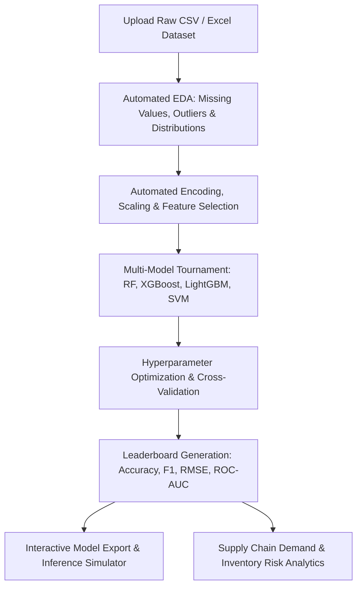

<div align="center">

  <!-- NATIVE ANIMATED CYBER BANNER -->
  

  <br/>

  <!-- ANIMATED TYPING SVG -->
  

  <br/>

  <!-- TECH BADGES -->
  <p align="center">
    
    
    
    
    
  </p>

</div>

---

### 🌟 System Overview

**AutoML Web Dashboard** is a comprehensive automated machine learning and business intelligence workspace. It allows data teams and business stakeholders to upload raw datasets, execute automated exploratory data analysis, train and benchmark multiple ML models, and generate predictive supply chain risk assessments.

---

### 🔬 Operational Architecture & Data Pipeline Flow



---

### 🚀 Key Capabilities & Features

- **⚙️ One-Click Data Preprocessing:** Automated imputation, standard scaling, and categorical one-hot/label encoding.
- **🏆 Multi-Model Tournament:** Trains and evaluates a fleet of regression and classification models in parallel.
- **📦 Supply Chain Intelligence:** Dedicated forecasting modules for demand variability, stockout risk, and safety stock levels.
- **💾 Model Export & Persistence:** Download trained serialized `.pkl` pipelines ready for production deployment.

---

### ⚡ Quickstart & Execution

```bash
# 1. Clone & enter
git clone https://github.com/Akshay-Notfound/AutoML-Web-Dashboard.git
cd AutoML-Web-Dashboard

# 2. Install requirements
pip install -r requirements.txt

# 3. Launch Dashboard
streamlit run app.py
```

---

### 👤 Author & Architecture

**Akshay Shivaji Rathod**  
*Data & AI Engineer*  
* 🌐 **Portfolio:** [akshay-notfound.vercel.app](https://akshay-notfound.vercel.app)  
* 💼 **LinkedIn:** [linkedin.com/in/akshay-rathod-aaab52206](https://www.linkedin.com/in/akshay-rathod-aaab52206/)  
* 🐙 **GitHub:** [@Akshay-Notfound](https://github.com/Akshay-Notfound)  

---

<div align="center">
  <sub>Licensed under the MIT License. Designed for scalability, intelligence, and performance.</sub>
</div>
